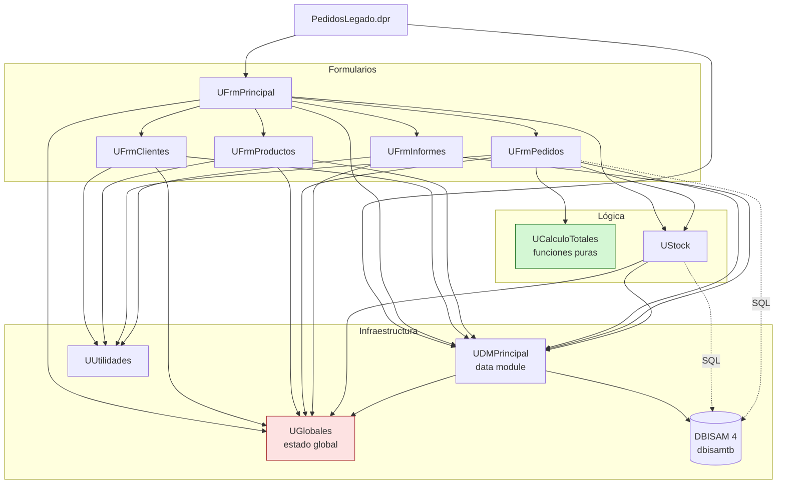
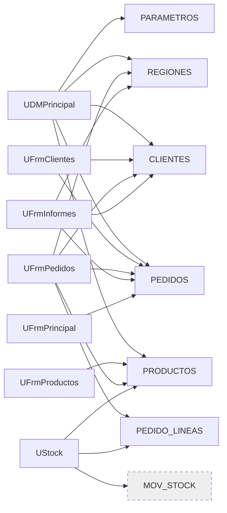
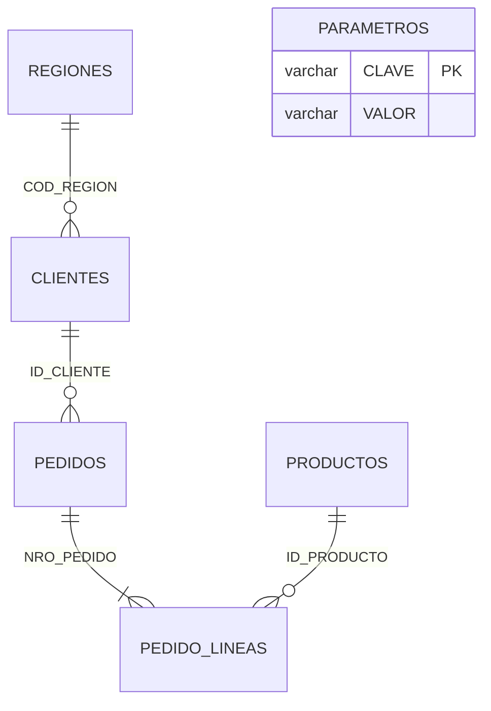

# Solución — Mapa de dependencias de referencia

> Documento exclusivo del instructor. Se obtiene de las cláusulas `uses` (interfaz e implementación) y de las referencias a tablas en el SQL embebido.

## Dependencias entre unidades

Observaciones que debería hacer un buen diagnóstico:

1. **`UCalculoTotales` no depende de nada** (ni siquiera de `SysUtils`): es la "hoja" del grafo y el mejor candidato para extraer primero (Unidad 5).
2. **`UGlobales` es usado por casi todo**: acoplamiento oculto. `UDMPrincipal` lo *escribe* (`gTasaIva`, `gMinimoPedido`, `gDirDatos`), `UFrmPrincipal` también (`gUsuarioActual`, `gNivelUsuario`) y el resto lo *lee*.
3. **`UFrmPedidos` es el nodo con más dependencias salientes** (5 unidades + BD directa).
4. `UStock` depende del data module (no recibe la conexión como parámetro): no se puede probar sin BD.
5. No hay ciclos en `interface`; las referencias cruzadas están en `implementation` (lo habitual en Delphi para evitarlos).
6. `UFrmInformes` **no** usa `UCalculoTotales`: es la raíz de la inconsistencia de IVA (R01).

## Unidades × tablas

`MOV_STOCK` aparece en el código (`src/UStock.pas:57`) pero **no existe en el esquema**: punto extra para quien lo detecte.

## Modelo de datos (referencia)

No hay claves foráneas declaradas en `esquema-dbisam.sql`: la integridad referencial depende solo del código.
